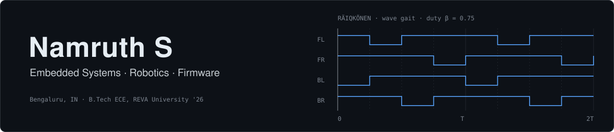
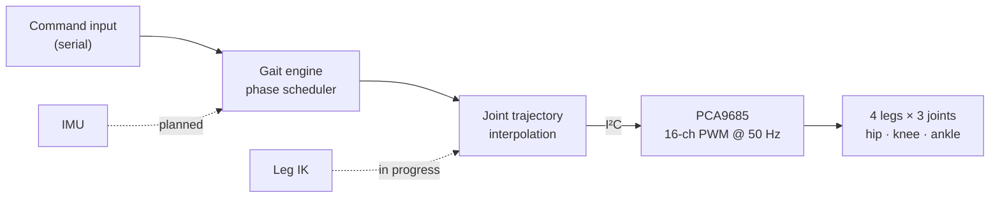

<picture>
  <source media="(prefers-color-scheme: dark)" srcset="assets/header-dark.svg">
  <source media="(prefers-color-scheme: light)" srcset="assets/header-light.svg">
  
</picture>

 

I design and build embedded systems — mostly robots. My work spans firmware, electronics and mechanical integration, and I usually own a system end to end: sensor selection and front-end, power, wiring, firmware architecture, comms link, and the operator interface.

I care about systems that behave predictably under load, fail in known ways, and are documented well enough that someone else can pick them up.

 

### Engineering focus

| Discipline | What that looks like in practice |
|:--|:--|
| **Real-time firmware** | FreeRTOS task partitioning on dual-core ESP32 — control path pinned to one core, sensor acquisition on the other, so actuator commands are not delayed by sensor I/O |
| **Motion control** | 12-DOF quadruped gait engine: per-joint calibration, interpolated trajectories, wave / ripple / crawl gaits |
| **Sensing & instrumentation** | Magnetometer + inductance-to-digital (LDC1000) screening, self-potential / induced-polarisation electrode front-end through an AD620 in-amp |
| **Wireless & comms** | LoRa-only command, telemetry and image relay designed to keep working while 2.4 GHz is jammed; dual-AP channel isolation; MQTT telemetry |
| **Robotics integration** | Rocker-bogie rover, pipe-inspection crawler, 6-axis arm driven from RoboDK over serial |
| **Embedded Linux** | Raspberry Pi 4 (Debian 13) as rover main controller — motor drivers, UART bridge to radio node, sensor fusion and mapping |
| **Hardware** | Schematic and PCB layout in KiCad, power budgeting, Li-ion + boost-converter power trees |

 

### RÄIQKÖNEN — quadruped platform

Long-running project: a four-legged robot built as a test bed for legged locomotion on terrain where wheels fail. It started as open-loop servo choreography and is being taken, one layer at a time, towards closed-loop, kinematics-driven walking.

| Layer | State |
|:--|:--|
| 12-DOF mechanism, servo calibration table, PCA9685 drive | Done |
| Gait library — wave, ripple, crawl, phoenix; posture set | Done |
| Inverse kinematics for foot placement in Cartesian space | In progress |
| IMU feedback for body levelling and slope compensation | Next |
| Move to STM32 + FreeRTOS with fixed-rate control loop | Planned |
| Custom carrier PCB (power distribution, servo headers, IMU) | Planned |

Named after Kimi Räikkönen.

 

### Other systems

| System | Problem | Disciplines |
|:--|:--|:--|
| **Seabed deposit sensor** | Classify metal-rich seafloor deposits with a two-stage screen → confirm sensing state machine *(SIH 2026, MoES / NCPOR)* | Instrumentation, analog front-end, sealed enclosure |
| **L.O.C.U.S.T.** | Surveillance rover that must operate with no Wi-Fi at all — control, telemetry and still images over 433 MHz LoRa | RF link design, Embedded Linux, odometry |
| **Sewer inspection robot** | Teleoperated crawler with drill and camera turret; video and control on separate radios to remove contention | FreeRTOS, motor control, IMU |
| **INEXIA** | 6-axis arm with trajectories planned in RoboDK and streamed to the controller | Kinematics, host ↔ MCU protocol |
| **ARGUS** | Scanning radar node publishing over MQTT to a live web dashboard | IoT, data pipeline |

 

### Toolchain

**Silicon** — ESP32 · STM32 · ATmega · Raspberry Pi 
**Firmware** — C / C++ · FreeRTOS · ESP-IDF / Arduino · I²C · SPI · UART · PWM 
**Comms** — LoRa (SX127x) · Wi-Fi SoftAP · MQTT 
**Hardware** — KiCad · bench instrumentation · Li-ion power design 
**Host side** — Python · OpenCV · RoboDK API

 

### Currently

- Closing the loop on RÄIQKÖNEN — IK first, then IMU-based stabilisation
- Learning STM32 HAL / LL and timer-driven control loops properly, not through abstractions
- Sensor fusion for wheel-odometry + IMU + ToF mapping on the LoRa rover

 

---

[LinkedIn](https://www.linkedin.com/in/namruth-s-80122b31a) · [exotic.namruth@gmail.com](mailto:exotic.namruth@gmail.com) · Bengaluru, India
