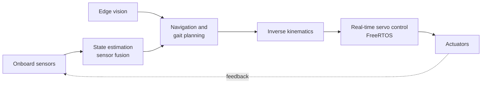

# Namruth S

Embedded systems · Robotics · Firmware

I design and build embedded systems across firmware, hardware, and system integration, with a focus on robotics and autonomous mobility. I work from concept through to deployment, and I care about deterministic timing, measurable performance, and designs that stay maintainable as they scale.

Electronics and Communication Engineering, REVA University.

 

## Engineering focus

| Discipline | Scope |
|:--|:--|
| Real-time firmware | Task scheduling and deterministic control loops on FreeRTOS |
| Embedded systems | Firmware for STM32 and ESP32 platforms |
| Motion control | Coordinated multi-servo control under real-time constraints |
| Robotics | Kinematics, gait generation and autonomous navigation for legged platforms |
| Sensor fusion | Combining multiple sensing sources into a state estimate for control |
| Hardware and PCB design | Schematic capture and board layout in KiCad |
| Embedded Linux | Raspberry Pi as a compute and integration layer |
| Edge AI and vision | Computer vision pipelines on embedded targets, built on OpenCV |
| Wireless and IoT | Sensor-driven wireless systems over MQTT |
| System integration | Bringing firmware, electronics and mechanics together into one working system |

 

## Featured work: RÄIQKÖNEN

A quadrupedal exploration robot for rough terrain and autonomous navigation. It is a long-running platform build covering hardware architecture, real-time control, sensing and onboard computation. Named after Kimi Räikkönen.

<!-- Verify this diagram against the actual architecture and edit labels to match. -->

**Supporting subsystems:** multi-servo real-time control, edge vision pipelines, custom PCB design, wireless sensing.

[Browse repositories](https://github.com/exotic-namruth?tab=repositories)

 

## Selected technologies

| | |
|:--|:--|
| Languages | C, C++, Python |
| Platforms | STM32, ESP32, Arduino, Raspberry Pi |
| Operating systems | FreeRTOS, Linux |
| Libraries and protocols | OpenCV, MQTT |
| Tools | KiCad, Git, VS Code |

 

## Currently

- Multi-servo real-time control for RÄIQKÖNEN
- Edge-based computer vision pipelines
- Custom PCB design and embedded hardware optimization
- Wireless, sensor-driven systems

Outside engineering: Formula 1, Oracle Red Bull Racing.

 

## GitHub

  
  
  
  

 

## Contact

[exotic.namruth@gmail.com](mailto:exotic.namruth@gmail.com) · [LinkedIn](https://www.linkedin.com/in/namruth-s-80122b31a)
